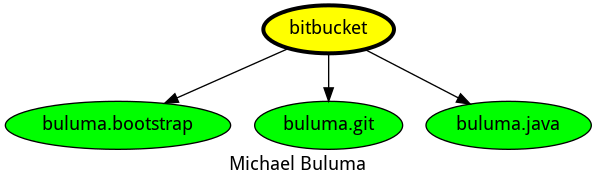

# [Ansible role bitbucket](#ansible-role-bitbucket)

Ansible Role for Atlassian Bitbucket Installation

|GitHub|Issues|Pull Requests|Version|Downloads|
|------|------|-------------|-------|---------|
|[](https://github.com/buluma/ansible-role-bitbucket/actions/workflows/molecule.yml)|[](https://github.com/buluma/ansible-role-bitbucket/issues/)|[](https://github.com/buluma/ansible-role-bitbucket/pulls/)|[](https://github.com/buluma/ansible-role-bitbucket/releases/)|[](https://galaxy.ansible.com/ui/standalone/roles/buluma/bitbucket/documentation)|

## [Example Playbook](#example-playbook)

This example is taken from [`molecule/default/converge.yml`](https://github.com/buluma/ansible-role-bitbucket/blob/master/molecule/default/converge.yml) and is tested on each push, pull request and release.

```yaml
---
- name: Converge
  hosts: all
  become: true
  gather_facts: true
  roles:
    - role: buluma.bitbucket
```

The machine needs to be prepared. In CI this is done using [`molecule/default/prepare.yml`](https://github.com/buluma/ansible-role-bitbucket/blob/master/molecule/default/prepare.yml):

```yaml
---
- name: Prepare
  hosts: all
  become: true
  gather_facts: false

  pre_tasks:
    - name: Install sudo if missing
      ansible.builtin.raw: "{{ ansible_pkg_mgr | default('dnf') }} install -y sudo"
      become: false
      changed_when: false
      failed_when: false

    - name: Install python3 if missing
      ansible.builtin.raw: >-
        if [ -x /usr/bin/python3 ]; then exit 0; fi;
        if command -v apt-get >/dev/null 2>&1; then apt-get update && apt-get install -y python3;
        elif command -v dnf >/dev/null 2>&1; then dnf install -y python3;
        elif command -v yum >/dev/null 2>&1; then yum install -y python3;
        elif command -v zypper >/dev/null 2>&1; then zypper -n install python3;
        else exit 1; fi
      become: false
      changed_when: false
      failed_when: false

    - name: Configure passwordless sudo
      ansible.builtin.raw: >-
        if ! grep -q '^%wheel ALL=(ALL) NOPASSWD: ALL' /etc/sudoers; then
          echo '%wheel ALL=(ALL) NOPASSWD: ALL' >> /etc/sudoers;
        fi;
        visudo -cf /etc/sudoers
      become: false
      changed_when: false
      failed_when: false

    - name: Gather platform facts
      ansible.builtin.setup:

    # Ubuntu 22.04 ships Git 2.34; the Git PPA now ships 2.56, which Bitbucket 10.2 also rejects.
    - name: Install Git build dependencies on Ubuntu 22.04
      ansible.builtin.apt:
        name:
          - build-essential
          - gettext
          - libcurl4-openssl-dev
          - libexpat1-dev
          - libssl-dev
          - zlib1g-dev
        state: present
        update_cache: true
      when:
        - ansible_facts['distribution'] == 'Ubuntu'
        - ansible_facts['distribution_version'] == '22.04'

    - name: Download Git 2.54 source on Ubuntu 22.04
      ansible.builtin.get_url:
        url: https://github.com/git/git/archive/refs/tags/v2.54.0.tar.gz
        dest: /tmp/git-2.54.0.tar.gz
        checksum: sha256:7b01a23c44c9ccfca2e3ad9daf8cbdd4d4caaaa6b5181e77e16e60c6ae5f772a
        mode: "0644"
      when:
        - ansible_facts['distribution'] == 'Ubuntu'
        - ansible_facts['distribution_version'] == '22.04'

    - name: Unpack Git source on Ubuntu 22.04
      ansible.builtin.unarchive:
        src: /tmp/git-2.54.0.tar.gz
        dest: /tmp
        remote_src: true
        creates: /tmp/git-2.54.0/Makefile
      when:
        - ansible_facts['distribution'] == 'Ubuntu'
        - ansible_facts['distribution_version'] == '22.04'

    - name: Build and install Git on Ubuntu 22.04
      ansible.builtin.command:
        argv:
          - make
          - -C
          - /tmp/git-2.54.0
          - -j2
          - prefix=/usr/local
          - install
        creates: /usr/local/bin/git
      when:
        - ansible_facts['distribution'] == 'Ubuntu'
        - ansible_facts['distribution_version'] == '22.04'

    - name: Read Git version on Ubuntu 22.04
      ansible.builtin.command: git --version
      changed_when: false
      register: _git_version
      when:
        - ansible_facts['distribution'] == 'Ubuntu'
        - ansible_facts['distribution_version'] == '22.04'

    - name: Check Git meets the Bitbucket requirement on Ubuntu 22.04
      ansible.builtin.assert:
        that:
          - _git_version.stdout.split()[-1] is version('2.42.0', '>=')
          - _git_version.stdout.split()[-1] is version('2.55.0', '<')
          - _git_version.stdout.split()[-1].split('.')[0:2] | join('.') not in ['2.48', '2.51', '2.52', '2.53']
        fail_msg: Bitbucket 10.2 requires a supported Git version between 2.42 and 2.54.
      when:
        - ansible_facts['distribution'] == 'Ubuntu'
        - ansible_facts['distribution_version'] == '22.04'

  roles:
    - role: buluma.bootstrap
    - role: buluma.epel
    - role: buluma.git
    - role: buluma.java
      java_version: 21
```

Also see a [full explanation and example](https://buluma.github.io/how-to-use-these-roles.html) on how to use these roles.

## [Role Variables](#role-variables)

The default values for the variables are set in [`defaults/main.yml`](https://github.com/buluma/ansible-role-bitbucket/blob/master/defaults/main.yml):

```yaml
---
bitbucket_autologin_cookie_age: "10080"
bitbucket_catalina: /opt/atlassian/bitbucket
bitbucket_catalina_connector_port: "7990"
bitbucket_catalina_connector_proxyname:
bitbucket_catalina_connector_proxyport:
bitbucket_catalina_connector_scheme:
bitbucket_catalina_connector_secure:
bitbucket_catalina_context_path:
bitbucket_group: bitbucket
bitbucket_home: /var/atlassian/application-data/bitbucket
bitbucket_jvm_maximum_memory: 2048m
bitbucket_jvm_minimum_memory: 2048m
bitbucket_jvm_reserved_code_cache_size: 512m
bitbucket_jvm_support_recommended_args: -Datlassian.plugins.enable.wait=300 -XX:+IgnoreUnrecognizedVMOptions -XX:+UnlockExperimentalVMOptions
bitbucket_owner: bitbucket
bitbucket_release: "10.2"
bitbucket_session_timeout: "120"
bitbucket_version: "{{ _bitbucket_version[bitbucket_release] }}"
```

## [Requirements](#requirements)

- pip packages listed in [requirements.txt](https://github.com/buluma/ansible-role-bitbucket/blob/master/requirements.txt).

## [State of used roles](#state-of-used-roles)

The following roles are used to prepare a system. You can prepare your system in another way.

| Requirement | GitHub |
|-------------|--------|
|[buluma.bootstrap](https://galaxy.ansible.com/buluma/bootstrap)|[](https://github.com/buluma/ansible-role-bootstrap/actions)|
|[buluma.epel](https://galaxy.ansible.com/buluma/epel)|[](https://github.com/buluma/ansible-role-epel/actions)|
|[buluma.git](https://galaxy.ansible.com/buluma/git)|[](https://github.com/buluma/ansible-role-git/actions)|
|[buluma.openjdk](https://galaxy.ansible.com/buluma/openjdk)|[](https://github.com/buluma/ansible-role-openjdk/actions)|
|[buluma.java](https://galaxy.ansible.com/buluma/java)|[](https://github.com/buluma/ansible-role-java/actions)|

## [Context](#context)

This role is part of many compatible roles. Have a look at [the documentation of these roles](https://buluma.github.io/) for further information.

Here is an overview of related roles:



## [Compatibility](#compatibility)

This role has been tested on these [container images](https://hub.docker.com/u/buluma):

|container|tags|
|---------|----|
|[EL](https://hub.docker.com/r/buluma/docker-molecule-images)|10, 9|
|[Debian](https://hub.docker.com/r/buluma/docker-molecule-images)|all|
|[Ubuntu](https://hub.docker.com/r/buluma/docker-molecule-images)|all|

Debian 11, Ubuntu 23.10, Fedora 38/39 and SUSE 15.5 are rejected because their configured OpenSUSE Build Service repositories are no longer available.

The minimum version of Ansible required is 2.19, tests have been done on:

- The previous version.
- The current version.
- The development version.

If you find issues, please register them on [GitHub](https://github.com/buluma/ansible-role-bitbucket/issues).

## [License](#license)

[Apache-2.0](https://github.com/buluma/ansible-role-bitbucket/blob/master/LICENSE).

## [Author Information](#author-information)

[buluma](https://buluma.github.io/)
